Студент 2 курса, иду в DevOps. Больше всего люблю Linux и железо: настраиваю свои сборки Linux, держу домашний сервер и собираю устройства на Raspberry Pi.

## Стек

**Использую**

**Учу сейчас**

## Проекты

| Проект | Что это | На чём |
|---|---|---|
| [NERV-OS](https://github.com/lkopik/NERV-OS) | Конфиги и скрипты, которые превращают дистрибутив Linux в NERV OS | Shell, Lua, CSS |
| [Rpi_pager](https://github.com/lkopik/Rpi_pager) | Пейджер: сообщения из Telegram-бота появляются на e-Paper дисплее Raspberry Pi Zero W | Python, Shell |
| [CyberFestTobol](https://github.com/lkopik/MEGA-PROGECT) | Командный проект CyberFestTobol | Python, HTML, Shell |
| [hyprland_Temperaturecheck](https://github.com/lkopik/hyprland_Temperaturecheck) | Показ температуры в панели waybar для Hyprland | Shell |
